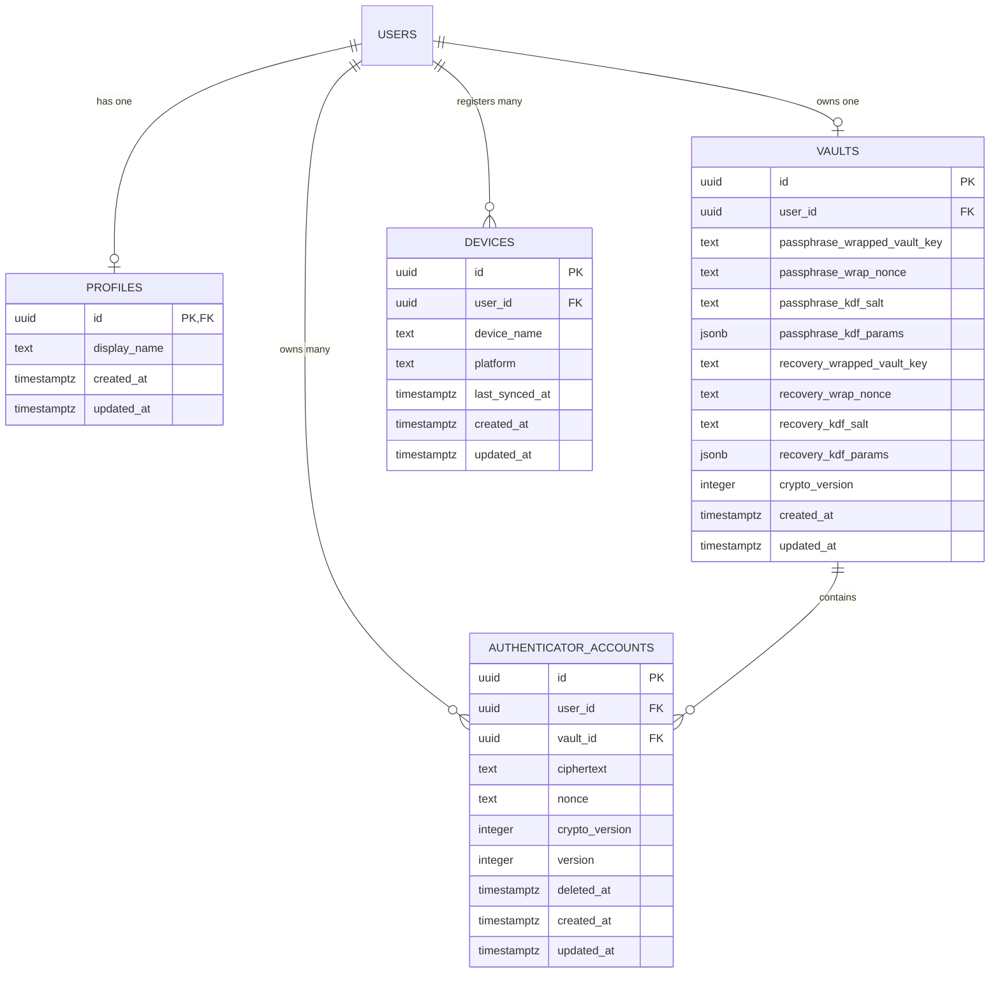

# NYX Database Architecture & Schema Specification

This document details the PostgreSQL schema, Row Level Security (RLS) policies, indexes, and synchronization constraints implemented for NYX in Supabase.

---

## 1. Database Schema Diagram



---

## 2. Table Definitions

### 2.1 `profiles`
Stores minimal public user profile information linked directly to `auth.users`.
- `id` (UUID, Primary Key, Foreign Key -> `auth.users.id` ON DELETE CASCADE)
- `display_name` (TEXT)
- `created_at` (TIMESTAMPTZ, NOT NULL, DEFAULT `now()`)
- `updated_at` (TIMESTAMPTZ, NOT NULL, DEFAULT `now()`)

### 2.2 `vaults`
Stores client-wrapped Vault Keys and KDF parameters. Never contains plaintext keys.
- `id` (UUID, Primary Key, DEFAULT `gen_random_uuid()`)
- `user_id` (UUID, NOT NULL, UNIQUE, Foreign Key -> `auth.users.id` ON DELETE CASCADE)
- `passphrase_wrapped_vault_key` (TEXT, NOT NULL)
- `passphrase_wrap_nonce` (TEXT, NOT NULL)
- `passphrase_kdf_salt` (TEXT, NOT NULL)
- `passphrase_kdf_params` (JSONB, NOT NULL)
- `recovery_wrapped_vault_key` (TEXT, NOT NULL)
- `recovery_wrap_nonce` (TEXT, NOT NULL)
- `recovery_kdf_salt` (TEXT, NOT NULL)
- `recovery_kdf_params` (JSONB, NOT NULL)
- `crypto_version` (INTEGER, NOT NULL, DEFAULT 1)
- `created_at` (TIMESTAMPTZ, NOT NULL, DEFAULT `now()`)
- `updated_at` (TIMESTAMPTZ, NOT NULL, DEFAULT `now()`)

### 2.3 `authenticator_accounts`
Stores client-side encrypted TOTP account records.
- `id` (UUID, Primary Key, DEFAULT `gen_random_uuid()`)
- `user_id` (UUID, NOT NULL, Foreign Key -> `auth.users.id` ON DELETE CASCADE)
- `vault_id` (UUID, NOT NULL, Foreign Key -> `vaults.id` ON DELETE CASCADE)
- `ciphertext` (TEXT, NOT NULL) - Encrypted JSON payload containing issuer, account name, base32 secret, algorithm, digits, period
- `nonce` (TEXT, NOT NULL) - 12-byte random IV/nonce encoded in base64
- `crypto_version` (INTEGER, NOT NULL, DEFAULT 1)
- `version` (INTEGER, NOT NULL, DEFAULT 1) - Optimistic concurrency integer
- `deleted_at` (TIMESTAMPTZ) - Soft delete timestamp for offline synchronization tombstones
- `created_at` (TIMESTAMPTZ, NOT NULL, DEFAULT `now()`)
- `updated_at` (TIMESTAMPTZ, NOT NULL, DEFAULT `now()`)

### 2.4 `devices`
Tracks registered client devices for auditing and push synchronization triggers.
- `id` (UUID, Primary Key, DEFAULT `gen_random_uuid()`)
- `user_id` (UUID, NOT NULL, Foreign Key -> `auth.users.id` ON DELETE CASCADE)
- `device_name` (TEXT, NOT NULL)
- `device_label` (TEXT) - Optional user-defined friendly name (e.g. 'Pixel 8 Pro (Primary)')
- `platform` (TEXT, NOT NULL, e.g., 'android')
- `last_synced_at` (TIMESTAMPTZ) - Timestamp of last successful synchronization
- `last_active_at` (TIMESTAMPTZ) - Heartbeat timestamp updated when device connects
- `created_at` (TIMESTAMPTZ, NOT NULL, DEFAULT `now()`)
- `updated_at` (TIMESTAMPTZ, NOT NULL, DEFAULT `now()`)

---

## 3. Row Level Security (RLS) Policies

All tables have RLS strictly enabled and forced.

### 3.1 Profiles RLS
- **Select:** `auth.uid() = id`
- **Insert:** `auth.uid() = id`
- **Update:** `auth.uid() = id`
- **Delete:** `auth.uid() = id`

### 3.2 Vaults RLS
- **Select:** `auth.uid() = user_id`
- **Insert:** `auth.uid() = user_id`
- **Update:** `auth.uid() = user_id`
- **Delete:** `auth.uid() = user_id`

### 3.3 Authenticator Accounts RLS
- **Select:** `auth.uid() = user_id`
- **Insert:** `auth.uid() = user_id`
- **Update:** `auth.uid() = user_id`
- **Delete:** `auth.uid() = user_id`

### 3.4 Devices RLS
- **Select:** `auth.uid() = user_id`
- **Insert:** `auth.uid() = user_id`
- **Update:** `auth.uid() = user_id`
- **Delete:** `auth.uid() = user_id`

---

## 4. Performance Indexes

```sql
CREATE INDEX idx_vaults_user_id ON vaults(user_id);
CREATE INDEX idx_authenticator_accounts_user_vault ON authenticator_accounts(user_id, vault_id);
CREATE INDEX idx_authenticator_accounts_sync ON authenticator_accounts(user_id, updated_at);
CREATE INDEX idx_devices_user_id ON devices(user_id);
```

---

## 5. Synchronization & Concurrency Constraints

1. **Atomic Compare-And-Swap (CAS) Concurrency:** Migration `20261123000003_atomic_cas_concurrency.sql` establishes the `sync_push_account` stored procedure. It locks the targeted account record using row-level locking (`FOR UPDATE`) and validates that the database version exactly matches the client's `p_expected_version`. Any competing update or stale push throws SQLSTATE `23514` (`check_violation`), guaranteeing that race conditions are caught atomically before records are overwritten.
2. **Optimistic Versioning Guard:** The PostgreSQL trigger `check_optimistic_concurrency()` executes `BEFORE UPDATE` on `authenticator_accounts`, enforcing that `NEW.version > OLD.version` for any direct updates.
3. **Tombstone Records & Anti-Resurrection:** When an account is deleted, a soft-delete tombstone (`deleted_at = now()`) is published with an incremented version counter. Reconcilers respect tombstones when `remote.version >= local.version`, preventing peer devices from resurrecting deleted accounts. If a client modified an account while offline and subsequently encounters a remote tombstone, the client preserves the offline modifications as a recovered copy (`(Restored from Deleted Copy)`) under a newly generated UUID, eliminating silent data loss.
4. **Cross-Tenant Vault Integrity:** Migration `20261123000001_harden_rls_policies.sql` guarantees that accounts can only be associated with vaults owned by the authenticated `auth.uid()`, eliminating cross-tenant injection risks.
5. **Device Metadata Tracking:** Migration `20261123000002_devices_last_active.sql` adds `last_active_at` and `device_label` to the `devices` table, allowing clients to monitor active sessions and identify enrolled hardware.
6. **Explicit Role Grants:** Migration `20261123000003_atomic_cas_concurrency.sql` explicitly grants table-level CRUD permissions and procedure execution to the `authenticated` role, ensuring operations are evaluated against Row-Level Security policies without table-level permission rejection.
7. **Safe Concurrent Creation & CAS Hardening:** Migration `20261123000004_safe_concurrent_cas.sql` hardens `sync_push_account`:
   - Wraps the missing-row insertion path in a sub-transaction trapping `unique_violation` (23505). If two devices concurrently create the same account UUID, the losing transaction re-selects the row with `FOR UPDATE` and raises a standard CAS concurrency conflict (`23514`), preventing unhandled database crashes.
   - Enforces strict target vault ownership verification (`42501 Unauthorized`).
   - Prevents cross-user account UUID collisions / hijacking (`42501 Forbidden`).
   - Guards soft-deleted tombstones against accidental resurrection with stale versions (`23514 Concurrency conflict`).
   - Verifies cross-vault integrity upon account updates.
8. **Atomic Multi-Account Vault Key Rotation (`sync_rotate_vault`):** Migration `20261123000005_atomic_vault_rotation.sql` provides the `sync_rotate_vault` stored procedure for transactional master key rotation:
   - Accepts wrapped vault envelope parameters alongside a JSONB array of re-encrypted accounts (`[{id, encrypted_payload, expected_version, next_version}]`).
   - Acquires `FOR UPDATE` row locks on the caller's row in `vaults` and every targeted row in `authenticator_accounts` inside a single PostgreSQL transaction.
   - Enforces ownership (`user_id = auth.uid()`) and strict monotonic versioning (`version = expected_version`) on every account. If any version mismatch occurs, the entire rotation transaction is rolled back with SQLSTATE `23514`.
   - Atomically updates the vault record and all account records in one commit. If an error occurs midway, zero partial accounts or envelopes are committed, eliminating partial-commit state corruption.
   - Declared `SECURITY DEFINER` with fixed `search_path = public` and explicit grant to `authenticated` role.
