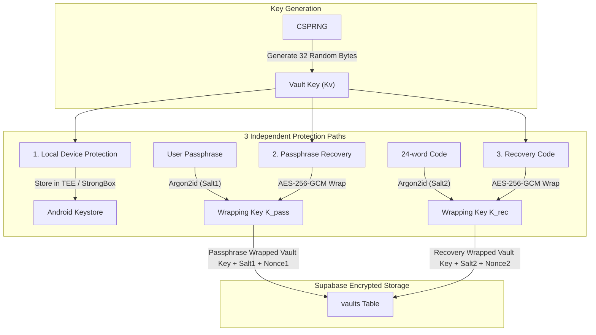

# NYX Cryptographic Architecture & Specifications

---

## 1. Principles & Threat Invariants

1. **Client-Side Exclusive Decryption:** All account records are encrypted and decrypted on the client device. Plaintext cryptographic secrets never touch the network or the cloud.
2. **Symmetric Vault Key Architecture:** A high-entropy 256-bit symmetric key ($K_v$) serves as the Master Vault Key.
3. **No Key Reuse Without Nonce Freshness:** AES-256-GCM authenticated encryption is used with a cryptographically secure 96-bit (12-byte) initialization vector (nonce) generated for each encryption operation.

---

## 2. Key Architecture & Wrapping Topology



---

## 3. Cryptographic Primitives & Specifications

### 3.1 Authenticated Account Encryption (AES-256-GCM)
- **Algorithm:** AES-256 in Galois/Counter Mode (GCM).
- **Key Length:** 256 bits (32 bytes).
- **Nonce/IV Length:** 96 bits (12 bytes) generated via `Crypto.getRandomValues`.
- **Authentication Tag:** 128 bits (16 bytes) appended to ciphertext.
- **Associated Data (AAD):** Bound to the `user_id` and `crypto_version` to prevent ciphertext substitution across accounts or protocol versions.

```json
{
  "crypto_version": 1,
  "nonce": "Base64EncodedNonce==",
  "ciphertext": "Base64EncodedCiphertextWithTag=="
}
```

### 3.2 Account Plaintext Structure (Before Encryption)
```json
{
  "id": "uuid-v4-identifier",
  "issuer": "Google",
  "account_name": "user@example.com",
  "secret": "JBSWY3DPEHPK3PXP",
  "algorithm": "SHA1",
  "digits": 6,
  "period": 30,
  "created_at": 1732363200000,
  "updated_at": 1732363200000
}
```

### 3.3 Key Derivation Function (Argon2id)
When wrapping the Vault Key for passphrase or recovery code storage:
- **Algorithm:** Argon2id (RFC 9106)
- **Memory Cost ($m$):** 65,536 KiB (64 MB)
- **Time Iterations ($t$):** 3 passes
- **Parallelism ($p$):** 4 threads
- **Salt:** 16 cryptographically secure random bytes
- **Derived Key Length:** 32 bytes (256 bits)

---

## 4. Local Keystore Integration (Android)

On Android devices:
1. When the user sets up NYX, a biometric-bound or hardware-backed master key is established in the **Android Keystore System** using AES-256 in GCM mode.
2. The Vault Key ($K_v$) is stored encrypted within `Expo SecureStore` backed by the Android Keystore.
3. Access requires user biometric authentication (`LocalAuthentication.authenticateAsync`) or device PIN fallback.
4. If biometric enrollment changes, the Keystore invalidates the key, prompting the user for their Master Passphrase to unwrap and re-bind $K_v$.

---

## 5. Emergency Recovery Protocol

If a device is lost or destroyed:
1. User installs NYX on a new device.
2. User authenticates via Supabase Auth (email/password).
3. Client downloads the encrypted record from `vaults` table containing:
   - `passphrase_wrapped_vault_key`, `passphrase_wrap_nonce`, `passphrase_kdf_salt`, `passphrase_kdf_params`
   - `recovery_wrapped_vault_key`, `recovery_wrap_nonce`, `recovery_kdf_salt`, `recovery_kdf_params`
4. The user enters either:
   - Their **Master Passphrase**, or
   - Their **24-word Recovery Code**.
5. The client re-derives the respective wrapping key using Argon2id with the downloaded salt and parameters.
6. The client unwraps and validates the Vault Key ($K_v$) via AES-256-GCM authentication tag verification.
7. Upon successful unwrapping, $K_v$ is saved into the new device's local Android Keystore, and all encrypted account records are pulled and decrypted locally.

---

## 6. Multi-Device Synchronization & Zero-Escrow Cryptography

### 6.1 Multi-Device Key Distribution Topology
NYX operates on a zero-knowledge, zero-escrow trust topology across multiple devices:
1. **No Key Escrow:** The backend never receives, processes, or stores the plaintext Vault Key ($K_v$).
2. **Deterministic Unwrapping:** When secondary devices (Device B, C...) enroll into an existing account, they retrieve the encrypted vault record from Supabase and independently unwrap $K_v$ using either the user's Master Passphrase or 24-word Recovery Code via Argon2id.
3. **Local Hardware Re-Binding:** Once unwrapped on the secondary device, $K_v$ is immediately saved into that device's local Android Keystore. Both devices now share the identical 256-bit symmetric key $K_v$ without any network transmission of the key.

### 6.2 Cloud Account Payload AAD Binding
Every account payload uploaded to the `authenticator_accounts` table is encrypted with AES-256-GCM under $K_v$.
- **Associated Authenticated Data (AAD):** `nyx-account:<account_uuid>:v1`
- **Rejection of Ciphertext Relocation:** If an attacker attempts to copy an encrypted account blob into another record or tamper with the record's UUID, GCM authentication tag verification fails immediately on the client during decryption.

### 6.3 Strict KDF Enforcement (Zero Silent Fallback)
`deriveKeyArgon2id` enforces RFC 9106 Argon2id via WebAssembly (`hash-wasm`). In the event of a runtime error or unsupported platform, it **throws an explicit fatal error**. It **never** silently falls back to weaker algorithms (such as PBKDF2), guaranteeing cryptographic consistency and security across all enrolled devices.

### 6.4 Forked Account Cryptographic Identity Invariance
When concurrent modifications or delete-versus-update conflicts occur:
1. The reconciler generates a fresh, cryptographically secure UUID (`crypto.randomUUID()`) for the preserved record.
2. The decrypted payload is re-encrypted via `reencryptForkedAccount()` using a fresh 96-bit random nonce and newly constructed AAD: `nyx-account:<fresh_uuid>:v1`.
3. Ciphertext from the prior identity is **never** copied or relocated. Any attempt to substitute ciphertext across account IDs fails AES-256-GCM authentication tag verification.

### 6.5 Master Vault Key Rotation ($K_v \to K_v'$)
Implemented in `VaultService.rotateVaultKey` (`frontend/src/services/vaultService.ts`):
1. **Fresh 256-bit Key Generation:** Generates a new random symmetric key $K_v'$ via CSPRNG.
2. **Local Re-Encryption:** All account records are decrypted using $K_v$ and re-encrypted with $K_v'$ using freshly generated 96-bit nonces and bound AAD.
3. **Argon2id Re-Wrapping:** $K_v'$ is wrapped under the Master Passphrase and emergency recovery code with fresh salts and nonces.
4. **Atomic Cloud Sync:** Remote `vaults` envelope is updated, and re-encrypted accounts are pushed via atomic CAS.
5. **Keystore Re-Binding:** Local Android Keystore is updated with $K_v'$. Any revoked or stolen device possessing only the old key $K_v$ cannot decrypt future records.

### 6.6 Memory Zeroization & Engine Lifetime Limits
- **ArrayBuffer Wiping:** Keys in `Uint8Array` format are wiped using `zeroMemory()` (`buffer.fill(0)`).
- **V8 Engine Garbage Collection Limitation:** JavaScript strings are immutable and cannot be overwritten in RAM. Their lifetime is managed by the engine's garbage collector. Zeroization is therefore documented as **best-effort**, with application defense-in-depth relying on `FLAG_SECURE` screen privacy and Android sandbox isolation.
