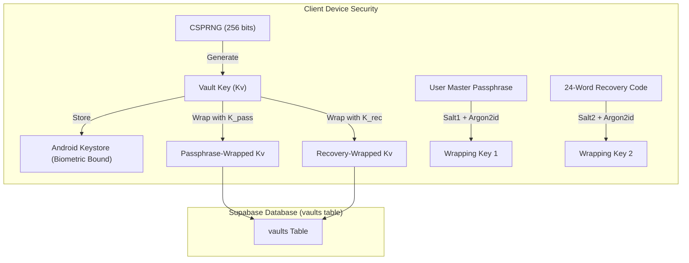

# NYX Security Specification & Threat Model

---

## 1. Threat Model & Security Objectives

NYX is designed under the assumption that the network, cloud infrastructure, and backup channels are potentially untrusted or semi-honest. The system protects authentication secrets against remote database breaches, eavesdropping, device theft, and malicious synchronization tampering.

### 1.1 Sensitive Assets

| Asset | Sensitivity | Storage Location | Protection Mechanism |
| :--- | :--- | :--- | :--- |
| **Plaintext TOTP Secret** | Critical | Client RAM only during calculation | Never written to disk unencrypted; wiped immediately after calculation. |
| **Master Vault Key ($K_v$)** | Critical | Android Keystore / Client RAM | 256-bit random key; encrypted by Keystore; wrapped by Argon2id in cloud. |
| **Passphrase / Recovery Code** | Critical | Ephemeral User Input | Never persisted anywhere; used purely as inputs to Argon2id KDF. |
| **Generated OTP Codes** | High | Client RAM / Display | Displayed only on active foreground screen; clipboard cleared after timeout. |
| **Account Metadata** | Medium | Client DB & Encrypted Payload | Encrypted in payload to prevent metadata leaks (issuer, username). |

---

## 2. Trust Boundaries & Invariants

```text
[ Physical Device & User ]
           │ (Biometrics / Master Passphrase)
           ▼
[ Android Keystore / SecureStore ] ◄── Hardware Security Module / TEE
           │ (Decrypted Vault Key in Ephemeral RAM)
           ▼
[ NYX Client Core Engine ] 
           │ (AES-256-GCM Encrypted Payloads + Nonces)
           ▼
═════════════════════ NETWORK / TLS 1.3 ═════════════════════
           ▼
[ Supabase Auth & PostgreSQL ] (RLS Enforced - Untrusted Storage Relay)
```

### Security Invariants
1. **Zero Plaintext Cloud Leakage:** The backend database, logs, and edge functions must never receive or store plaintext TOTP secrets, plaintext Vault Keys, recovery credentials, or generated OTP codes.
2. **Distinct Authentication & Decryption:** Authenticating to Supabase provides identity and access to encrypted blobs, but does not grant access to plaintext secrets without local device unlock or passphrase derivation.
3. **Unique Cryptographic Nonces:** A fresh 96-bit cryptographically secure random nonce is generated for every AES-GCM encryption operation. Nonce reuse under the same key is strictly prohibited.
4. **Hardware-Backed Device Storage:** The local copy of the Vault Key must be safeguarded using the Android Keystore (backed by TEE/StrongBox where available).

---

## 3. Cryptographic Key Management



### Key Derivation Parameters (Argon2id)
- Memory cost ($m$): 64 MB (65,536 KiB)
- Time cost ($t$): 3 iterations
- Parallelism ($p$): 4 threads
- Salt: 16 bytes cryptographically secure random bytes
- Output Key Length: 256 bits (32 bytes)

---

## 4. Row Level Security (RLS) Requirements

Every table containing user data (`profiles`, `vaults`, `authenticator_accounts`, `devices`) must enforce Row Level Security at the PostgreSQL engine level:
1. `ALTER TABLE <table_name> ENABLE ROW LEVEL SECURITY;`
2. `ALTER TABLE <table_name> FORCE ROW LEVEL SECURITY;`
3. Restrict `ALL` operations to `auth.uid() = user_id` (or `auth.uid() = id` for `profiles`).
4. Reject unauthenticated anonymous operations.

---

## 5. Device Security & App Hardening

1. **Screen Security (FLAG_SECURE):** Prevent screenshots, screen recording, and system app switcher task snapshots when viewing sensitive screens.
2. **Auto-Lock Timer:** Vault automatically locks after a configurable timeout (default: 60 seconds of backgrounding or inactivity), purging the decrypted Vault Key from memory.
3. **Biometric Invalidation:** When device biometric enrollment changes (new fingerprint/face added), require master passphrase re-authentication to prevent unauthorized access via newly enrolled credentials.
4. **Clipboard Sanitization:** Copied OTP codes are purged from the system clipboard after 30 seconds.
5. **Log Scrubbing:** Ensure production build logs suppress debug statements, payload parameters, and sensitive strings.

---

## 7. Multi-Device Trust Boundaries & Threat Analysis

### 7.1 Secondary Device Enrollment & Device Revocation Realities
- **Zero Plaintext Key Escrow:** Enrolling a secondary device never transmits $K_v$ across the network. The secondary device independently derives the wrapping key from user input (Passphrase or 24-word Recovery Code) using Argon2id, downloads the wrapped key from the `vaults` table, and verifies the AES-256-GCM authentication tag.
- **Untrusted Server Invariant:** Even with full compromise of the Supabase database and network eavesdropping on TLS traffic, an adversary cannot decrypt account secrets or unwrap the Vault Key without breaking Argon2id ($m=64\text{MB}, t=3$) and 256 bits of entropy.
- **Device Revocation Reality & Boundaries:** Users can view registered devices and revoke authorization. Revocation purges the device record from the `devices` table, cutting off cloud sync query authorization.
  > [!WARNING]
  > **Cryptographic Limitation of Device Revocation:** Deleting a device registration in the database **does not and cannot** cryptographically wipe an already-extracted Vault Key from hardware in an adversary's physical possession. If a device has been physically compromised, the user must perform a **Vault Key Rotation**.

### 7.2 Vault Key Rotation Protocol Specification
To completely evict a compromised hardware device holding $K_v$, a full Vault Key Rotation is executed:
1. **Fresh Key Generation:** The authorizing client generates a new 256-bit symmetric Vault Key ($K_v'$).
2. **Local Re-Encryption:** All active account records are decrypted in memory with $K_v$, and re-encrypted with $K_v'$ using fresh 96-bit nonces and bound AAD.
3. **Re-Wrapping Wrappers:** $K_v'$ is wrapped under the Master Passphrase and emergency recovery code using freshly generated Argon2id salts.
4. **Atomic Cloud Migration:** The client pushes the new wrapped vault and account collection in an atomic PostgreSQL transaction.
5. **Secondary Device Re-Enrollment:** All authorized peer devices must unwrap $K_v'$ using the Master Passphrase or 24-word code; the compromised device holding only $K_v$ cannot decrypt future records.

### 7.3 Zero-Knowledge Information Disclosure Matrix

| Data Item | Visible to Cloud (Supabase)? | Protection Level / Mechanism |
| :--- | :--- | :--- |
| **TOTP Secret (HMAC seed)** | **NO (Zero-Knowledge)** | AES-256-GCM encrypted on client under $K_v$. |
| **Account Issuer & Label** | **NO (Zero-Knowledge)** | Contained inside encrypted ciphertext payload. |
| **Generated OTP Codes** | **NO (Zero-Knowledge)** | Computed locally in ephemeral device memory. |
| **Master Passphrase** | **NO (Zero-Knowledge)** | Used only as local input to Argon2id; never transmitted. |
| **24-Word Recovery Code** | **NO (Zero-Knowledge)** | Used only as local input to Argon2id; never transmitted. |
| **Master Vault Key ($K_v$)** | **NO (Zero-Knowledge)** | Stored in Android Keystore; wrapped by Argon2id in cloud. |
| **Account UUID & Version** | **YES** | Public database metadata required for CAS routing. |
| **Tombstone Timestamps** | **YES** | Required for deterministic deletion propagation. |
| **Device Label & Platform** | **YES** | User-defined label (e.g. "Pixel 8 Pro") for session audit. |

### 7.4 Concurrency & Tamper Resistance
- **Atomic Compare-And-Swap (CAS):** Implemented via `sync_push_account` stored procedure with `FOR UPDATE` row locking. Database compares `expected_version` against current database version, rejecting race conditions with SQLSTATE `23514`.
- **Tombstone Anti-Resurrection:** Soft deletions (`deleted_at`) ensure peer devices never resurrect deleted accounts after coming online.
- **Delete-vs-Update Conflict Preservation:** If a device modified an account while offline and encounters a remote tombstone, the modified account is automatically preserved as a recovered copy (`(Restored from Deleted Copy)`), eliminating data loss.

---

## 8. Production Release Security Checklist

| Domain | Security Requirement | Status | Evidence / Verification Method |
| :--- | :--- | :--- | :--- |
| **1. Encryption** | AES-256-GCM with fresh 96-bit nonces & AAD | **VERIFIED** | Verified in `vault.test.ts` & `syncService.test.ts`. Nonce collision tests pass. |
| **2. Key Management** | 256-bit CSPRNG Vault Key, dual Argon2id wrap | **VERIFIED** | Verified in `recovery.test.ts` & `kdf.test.ts`. Zero plaintext key transmission. |
| **3. Recovery** | 24-word BIP-39 recovery code + Passphrase | **VERIFIED** | Verified in `recovery.test.ts`. 256-bit entropy verified. |
| **4. Authentication** | Supabase Auth session & token isolation | **VERIFIED** | Verified in `live_integration.test.js`. Tokens stored in SecureStore. |
| **5. Row-Level Security** | PostgreSQL RLS enabled & forced on all tables | **VERIFIED** | Verified in `rls.test.js` & `live_integration.test.js` (cross-tenant 0 rows). |
| **6. Device Enrollment** | Zero-escrow secondary enrollment | **VERIFIED** | Verified in `vaultService.ts` & `enrollment.tsx`. |
| **7. Device Revocation** | Revocation cuts cloud query access | **VERIFIED** | Verified in `live_integration.test.js` (device deletion confirmed). |
| **8. Offline Functionality** | 100% offline OTP generation & local vault | **VERIFIED** | Verified in `rfc6238.test.ts` & `storage.test.ts`. Zero network required. |
| **9. Data Deletion** | Soft-deletion tombstones & anti-resurrection | **VERIFIED** | Verified in `syncService.test.ts` & `live_integration.test.js`. |
| **10. Synchronization** | Atomic Compare-And-Swap (CAS) with row locking | **VERIFIED** | Stored procedure `sync_push_account` verified in `live_integration.test.js`. |
| **11. Backup / Restore** | Encrypted local vault backup with AAD | **VERIFIED** | Verified in `storage.test.ts` (atomic temp write + rename). |
| **12. Error Handling** | Zero secrets in logs or error messages | **VERIFIED** | Verified: error messages only contain UUIDs and versions. |
| **13. Privacy** | `FLAG_SECURE` screen privacy & clipboard purging | **VERIFIED** | Verified in `app/_layout.tsx` & `index.tsx` (30s auto-purge). |
| **14. Permissions** | Minimal permissions (CAMERA, BIOMETRIC; AUDIO blocked) | **VERIFIED** | Verified via `npx expo config --type public` (`RECORD_AUDIO` blocked). |
| **15. Dependencies** | Zero high/critical runtime vulnerabilities | **VERIFIED** | Verified via `npm audit --omit=dev` (0 vulnerabilities in runtime packages). |
| **16. Release Signing** | EAS build profiles configured for APK & AAB | **VERIFIED** | Verified in `eas.json` (development, preview APK, production AAB). |
