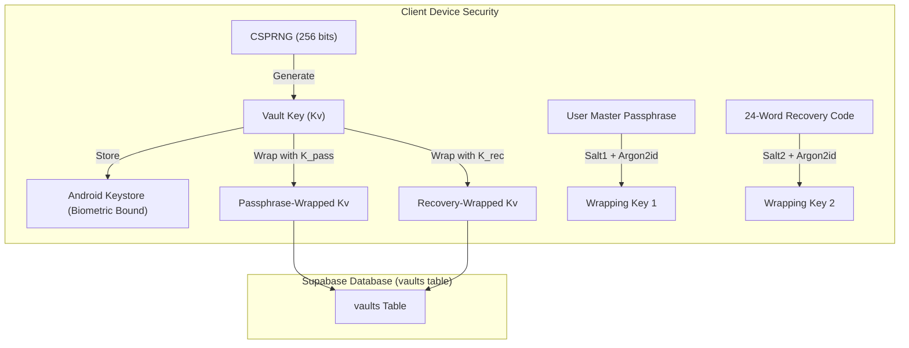

# NYX Security Specification & Threat Model

---

## 1. Threat Model & Security Objectives

NYX is designed under the assumption that the network, cloud infrastructure, and backup channels are potentially untrusted or semi-honest. The system protects authentication secrets against remote database breaches, eavesdropping, device theft, and malicious synchronization tampering.

### 1.1 Sensitive Assets

| Asset | Sensitivity | Storage Location | Protection Mechanism |
| :--- | :--- | :--- | :--- |
| **Plaintext TOTP Secret** | Critical | Client RAM only during calculation | Never written to disk unencrypted; wiped immediately after calculation. |
| **Master Vault Key ($K_v$)** | Critical | Android Keystore / Client RAM | 256-bit random key; encrypted by Keystore; wrapped by Argon2id in cloud. |
| **Passphrase / Recovery Code** | Critical | Ephemeral User Input | Never persisted anywhere; used purely as inputs to Argon2id KDF. |
| **Generated OTP Codes** | High | Client RAM / Display | Displayed only on active foreground screen; clipboard cleared after timeout. |
| **Account Metadata** | Medium | Client DB & Encrypted Payload | Encrypted in payload to prevent metadata leaks (issuer, username). |

---

## 2. Trust Boundaries & Invariants

```text
[ Physical Device & User ]
           │ (Biometrics / Master Passphrase)
           ▼
[ Android Keystore / SecureStore ] ◄── Hardware Security Module / TEE
           │ (Decrypted Vault Key in Ephemeral RAM)
           ▼
[ NYX Client Core Engine ] 
           │ (AES-256-GCM Encrypted Payloads + Nonces)
           ▼
═════════════════════ NETWORK / TLS 1.3 ═════════════════════
           ▼
[ Supabase Auth & PostgreSQL ] (RLS Enforced - Untrusted Storage Relay)
```

### Security Invariants
1. **Zero Plaintext Cloud Leakage:** The backend database, logs, and edge functions must never receive or store plaintext TOTP secrets, plaintext Vault Keys, recovery credentials, or generated OTP codes.
2. **Distinct Authentication & Decryption:** Authenticating to Supabase provides identity and access to encrypted blobs, but does not grant access to plaintext secrets without local device unlock or passphrase derivation.
3. **Unique Cryptographic Nonces:** A fresh 96-bit cryptographically secure random nonce is generated for every AES-GCM encryption operation. Nonce reuse under the same key is strictly prohibited.
4. **Hardware-Backed Device Storage:** The local copy of the Vault Key must be safeguarded using the Android Keystore (backed by TEE/StrongBox where available).

---

## 3. Cryptographic Key Management



### Key Derivation Parameters (Argon2id)
- Memory cost ($m$): 64 MB (65,536 KiB)
- Time cost ($t$): 3 iterations
- Parallelism ($p$): 4 threads
- Salt: 16 bytes cryptographically secure random bytes
- Output Key Length: 256 bits (32 bytes)

---

## 4. Row Level Security (RLS) Requirements

Every table containing user data (`profiles`, `vaults`, `authenticator_accounts`, `devices`) must enforce Row Level Security at the PostgreSQL engine level:
1. `ALTER TABLE <table_name> ENABLE ROW LEVEL SECURITY;`
2. `ALTER TABLE <table_name> FORCE ROW LEVEL SECURITY;`
3. Restrict `ALL` operations to `auth.uid() = user_id` (or `auth.uid() = id` for `profiles`).
4. Reject unauthenticated anonymous operations.

---

## 5. Device Security & App Hardening

1. **Screen Security (FLAG_SECURE):** Prevent screenshots, screen recording, and system app switcher task snapshots when viewing sensitive screens.
2. **Auto-Lock Timer:** Vault automatically locks after a configurable timeout (default: 60 seconds of backgrounding or inactivity), purging the decrypted Vault Key from memory.
3. **Biometric Invalidation:** When device biometric enrollment changes (new fingerprint/face added), require master passphrase re-authentication to prevent unauthorized access via newly enrolled credentials.
4. **Clipboard Sanitization:** Copied OTP codes are purged from the system clipboard after 30 seconds.
5. **Log Scrubbing:** Ensure production build logs suppress debug statements, payload parameters, and sensitive strings.

---

## 6. Security Review Checklist

Before releasing any version or updating cryptographic routines:
- [ ] Are all account secrets encrypted using AES-256-GCM before database insertion?
- [ ] Is a fresh 96-bit nonce generated for every encryption?
- [ ] Are Argon2id parameters compliant with OWASP password storage recommendations?
- [ ] Are RLS policies tested against cross-tenant read/write exploits?
- [ ] Is the decrypted Vault Key cleared from memory upon app backgrounding?
- [ ] Are logs free of unencrypted secrets, OTPs, or key material?
- [ ] Are all dependencies checked against known vulnerabilities (`npm audit`)?
