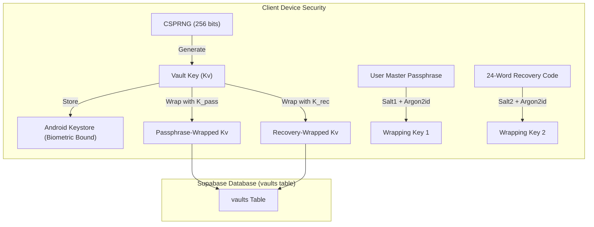

# NYX Security Specification & Threat Model

---

## 1. Threat Model & Security Objectives

NYX is designed under the assumption that the network, cloud infrastructure, and backup channels are potentially untrusted or semi-honest. The system protects authentication secrets against remote database breaches, eavesdropping, device theft, and malicious synchronization tampering.

### 1.1 Sensitive Assets

| Asset | Sensitivity | Storage Location | Protection Mechanism |
| :--- | :--- | :--- | :--- |
| **Plaintext TOTP Secret** | Critical | Client RAM only during calculation | Never written to disk unencrypted; wiped immediately after calculation. |
| **Master Vault Key ($K_v$)** | Critical | Android Keystore / Client RAM | 256-bit random key; encrypted by Keystore; wrapped by Argon2id in cloud. |
| **Passphrase / Recovery Code** | Critical | Ephemeral User Input | Never persisted anywhere; used purely as inputs to Argon2id KDF. |
| **Generated OTP Codes** | High | Client RAM / Display | Displayed only on active foreground screen; clipboard cleared after timeout. |
| **Account Metadata** | Medium | Client DB & Encrypted Payload | Encrypted in payload to prevent metadata leaks (issuer, username). |

---

## 2. Trust Boundaries & Invariants

```text
[ Physical Device & User ]
           │ (Biometrics / Master Passphrase)
           ▼
[ Android Keystore / SecureStore ] ◄── Hardware Security Module / TEE
           │ (Decrypted Vault Key in Ephemeral RAM)
           ▼
[ NYX Client Core Engine ] 
           │ (AES-256-GCM Encrypted Payloads + Nonces)
           ▼
═════════════════════ NETWORK / TLS 1.3 ═════════════════════
           ▼
[ Supabase Auth & PostgreSQL ] (RLS Enforced - Untrusted Storage Relay)
```

### Security Invariants
1. **Zero Plaintext Cloud Leakage:** The backend database, logs, and edge functions must never receive or store plaintext TOTP secrets, plaintext Vault Keys, recovery credentials, or generated OTP codes.
2. **Distinct Authentication & Decryption:** Authenticating to Supabase provides identity and access to encrypted blobs, but does not grant access to plaintext secrets without local device unlock or passphrase derivation.
3. **Unique Cryptographic Nonces:** A fresh 96-bit cryptographically secure random nonce is generated for every AES-GCM encryption operation. Nonce reuse under the same key is strictly prohibited.
4. **Hardware-Backed Device Storage:** The local copy of the Vault Key must be safeguarded using the Android Keystore (backed by TEE/StrongBox where available).

---

## 3. Cryptographic Key Management



### Key Derivation Parameters (Argon2id)
- Memory cost ($m$): 64 MB (65,536 KiB)
- Time cost ($t$): 3 iterations
- Parallelism ($p$): 4 threads
- Salt: 16 bytes cryptographically secure random bytes
- Output Key Length: 256 bits (32 bytes)

---

## 4. Row Level Security (RLS) Requirements

Every table containing user data (`profiles`, `vaults`, `authenticator_accounts`, `devices`) must enforce Row Level Security at the PostgreSQL engine level:
1. `ALTER TABLE <table_name> ENABLE ROW LEVEL SECURITY;`
2. `ALTER TABLE <table_name> FORCE ROW LEVEL SECURITY;`
3. Restrict `ALL` operations to `auth.uid() = user_id` (or `auth.uid() = id` for `profiles`).
4. Reject unauthenticated anonymous operations.

---

## 5. Device Security & App Hardening

1. **Screen Security (FLAG_SECURE):** Prevent screenshots, screen recording, and system app switcher task snapshots when viewing sensitive screens.
2. **Auto-Lock Timer:** Vault automatically locks after a configurable timeout (default: 60 seconds of backgrounding or inactivity), purging the decrypted Vault Key from memory.
3. **Biometric Invalidation:** When device biometric enrollment changes (new fingerprint/face added), require master passphrase re-authentication to prevent unauthorized access via newly enrolled credentials.
4. **Clipboard Sanitization:** Copied OTP codes are purged from the system clipboard after 30 seconds.
5. **Log Scrubbing:** Ensure production build logs suppress debug statements, payload parameters, and sensitive strings.

---

## 7. Multi-Device Trust Boundaries & Threat Analysis

### 7.1 Secondary Device Enrollment & Device Revocation Realities
- **Zero Plaintext Key Escrow:** Enrolling a secondary device never transmits $K_v$ across the network. The secondary device independently derives the wrapping key from user input (Passphrase or 24-word Recovery Code) using Argon2id, downloads the wrapped key from the `vaults` table, and verifies the AES-256-GCM authentication tag.
- **Untrusted Server Invariant:** Even with full compromise of the Supabase database and network eavesdropping on TLS traffic, an adversary cannot decrypt account secrets or unwrap the Vault Key without breaking Argon2id ($m=64\text{MB}, t=3$) and 256 bits of entropy.
- **Device Revocation Reality & Boundaries:** Users can view registered devices and revoke authorization. Revocation purges the device record from the `devices` table, cutting off cloud sync query authorization.
  > [!WARNING]
  > **Cryptographic Limitation of Device Revocation:** Deleting a device registration in the database **does not and cannot** cryptographically wipe an already-extracted Vault Key from hardware in an adversary's physical possession. If a device has been physically compromised, the user must perform a **Vault Key Rotation**.

### 7.2 Two-Phase Recoverable Vault Key Rotation Protocol
To completely evict a compromised hardware device holding $K_v$, a full Vault Key Rotation is executed using a crash-recoverable two-phase protocol with on-disk state tracking (`nyx_rotation_manifest_v1.json`):
1. **Pre-flight Decryption Verification:** Before any state mutation occurs, the client verifies that the current $K_v$ can successfully decrypt all local accounts. If decryption fails, the operation aborts immediately with zero modification to disk or cloud.
2. **State 1 (`PREPARED`):** 
   - A fresh 256-bit symmetric Vault Key ($K_v'$) is generated via CSPRNG.
   - All active local accounts are decrypted in memory with $K_v$ and re-encrypted with $K_v'$ using fresh 96-bit nonces and bound AAD (`nyx-account:<id>:v1`).
   - $K_v'$ is wrapped under the Master Passphrase and emergency recovery code using freshly generated Argon2id salts.
   - The state manifest is atomically written to disk recording stage `PREPARED`, the new wrapped envelope, and the re-encrypted accounts. The old key $K_v$ remains active in Keystore and storage.
3. **State 2 (`CLOUD_COMMITTED`):** 
   - The client pushes the new wrapped vault envelope and re-encrypted accounts to Supabase in an atomic CAS operation.
   - Once cloud write succeeds, the manifest stage transitions to `CLOUD_COMMITTED` on disk.
4. **Local Commit & Cleanup (`COMPLETED`):**
   - $K_v'$ is committed to the local Android Keystore (`KeystoreService.saveVaultKey`).
   - Local storage is overwritten with the newly encrypted accounts.
   - The client performs a post-flight decryption check using $K_v'$ to verify that accounts load cleanly.
   - The on-disk rotation manifest is deleted.
5. **Startup Crash Recovery (`recoverInterruptedRotation`):**
   - If the application crashes or is killed during `PREPARED`, startup recovery discards the manifest; the cloud and local Keystore still hold $K_v$, so the user experiences zero disruption.
   - If the application crashes during `CLOUD_COMMITTED`, the cloud already has $K_v'$ while the local Keystore still has $K_v$. On reboot, `recoverInterruptedRotation` reads the manifest, commits $K_v'$ to the local Keystore and storage, and purges the manifest, guaranteeing the user is never locked out.
6. **Secondary Device Re-Enrollment:** All authorized peer devices unwrap $K_v'$ using the Master Passphrase or 24-word code; the compromised device holding only $K_v$ cannot decrypt future records.

### 7.3 Zero-Knowledge Information Disclosure Matrix

| Data Item | Visible to Cloud (Supabase)? | Protection Level / Mechanism |
| :--- | :--- | :--- |
| **TOTP Secret (HMAC seed)** | **NO (Zero-Knowledge)** | AES-256-GCM encrypted on client under $K_v$. |
| **Account Issuer & Label** | **NO (Zero-Knowledge)** | Contained inside encrypted ciphertext payload. |
| **Generated OTP Codes** | **NO (Zero-Knowledge)** | Computed locally in ephemeral device memory. |
| **Master Passphrase** | **NO (Zero-Knowledge)** | Used only as local input to Argon2id; never transmitted. |
| **24-Word Recovery Code** | **NO (Zero-Knowledge)** | Used only as local input to Argon2id; never transmitted. |
| **Master Vault Key ($K_v$)** | **NO (Zero-Knowledge)** | Stored in Android Keystore; wrapped by Argon2id in cloud. |
| **Account UUID & Version** | **YES** | Public database metadata required for CAS routing. |
| **Tombstone Timestamps** | **YES** | Required for deterministic deletion propagation. |
| **Device Label & Platform** | **YES** | User-defined label (e.g. "Pixel 8 Pro") for session audit. |

### 7.4 Concurrency, CAS Race Mitigation & Tamper Resistance
- **Atomic Compare-And-Swap (CAS):** Implemented via `sync_push_account` stored procedure with `FOR UPDATE` row locking. Database compares `expected_version` against current database version, rejecting race conditions with SQLSTATE `23514`.
- **Missing-Row Insertion Race Protection (Migration 4):** Standard `FOR UPDATE` does not lock non-existent rows. In `sync_push_account` (migration `20261123000004_safe_concurrent_cas.sql`), concurrent insertions targeting the same UUID are wrapped in a sub-transaction trapping `unique_violation` (23505). If another transaction won the race, it re-locks the row and raises a standard CAS concurrency conflict (`23514`), allowing clean client reconciliation without unhandled database exceptions.
- **Tombstone Anti-Resurrection & Accidental Resurrection Guard:** Soft deletions (`deleted_at`) ensure peer devices never resurrect deleted accounts after coming online. In `sync_push_account`, attempts to update a soft-deleted tombstone with a stale version or without monotonic version increment are rejected with `23514`.
- **Delete-vs-Update Conflict Preservation:** If a device modified an account while offline and encounters a remote tombstone, the modified account is automatically preserved as a recovered copy (`(Restored from Deleted Copy)`), eliminating data loss.

### 7.5 Crash-Safe Persistent Mutation Queue (Write-Ahead Journaling & Integrity)
- **Durable State Machine:** The offline queue in `PersistentMutationQueue` implements a 5-stage state machine:
  $$\text{ENQUEUED} \longrightarrow \text{PROCESSING} \longrightarrow \text{ACKNOWLEDGED} \quad (\text{or } \text{RETRYING} / \text{PERMANENTLY\_FAILED})$$
- **Queue Mutex Serialization (`runExclusive`):** All concurrent async queue operations (`enqueue`, `markProcessing`, `acknowledge`, `recordFailure`, `recoverInterruptedMutations`, `loadJournal`) are serialized via an internal async lock to eliminate concurrent read-modify-write race conditions and lost updates.
- **Journal Envelope & Integrity Checksums:** The journal is persisted in `nyx_mutation_queue_v1.journal` with a versioned envelope (`schemaVersion: 1`, `checksum`, `updatedAt`). On load, SHA-256 integrity checksums detect truncation or partial writes.
- **Backup Rotation & Auto-Repair:** On every atomic write, the prior journal is rotated to `nyx_mutation_queue_v1.journal.bak`. If the primary journal is corrupted or truncated, the queue automatically recovers from `.bak` and repairs the primary file. If both are unrecoverable, the corrupted journal is safely archived to `nyx_mutation_queue_v1.journal.corrupted.<timestamp>`, and orphaned `.tmp` files are cleaned up.
- **Interruption Recovery on Startup:** If the application terminates or is killed by the OS during an active upload (leaving mutations in `PROCESSING`), `recoverInterruptedMutations` queries the server on app reboot. If the remote version indicates the server write succeeded before local acknowledgement, the mutation is cleanly acknowledged. If not, it is safely reset to `ENQUEUED` for idempotent retry.
- **Bounded Backoff & Error Classification:** Transient network failures trigger bounded exponential backoff ($500\text{ ms} \times 2^{\text{retry}} + \text{jitter}$, max 30s). Permanent failures (`42501 Unauthorized`) transition immediately to `PERMANENTLY_FAILED`, preventing infinite retry loops.

### 7.6 Android Hardware Keystore & Physical Device Reality
- **Physical Hardware Verification Status:** `NOT TESTED (SIMULATOR / MOCK ENVIRONMENT)`. In this automated build environment, no physical Android device is connected (`adb devices` returned empty). While Expo SecureStore delegates to Android Keystore (`EncryptedSharedPreferences`), hardware-backed TEE/StrongBox enforcement (`KeyProperties.SECURITY_LEVEL_STRONGBOX`) and hardware key invalidation cannot be claimed without physical device probe testing.
- **Biometric Enforcement Boundary:** Biometric unlock in `KeystoreService` is currently gated at the application software level via `expo-local-authentication` before retrieving the key from SecureStore.

### 7.7 JavaScript Memory Lifetime & Best-Effort Zeroization
- **ArrayBuffer Zeroization:** Raw cryptographic keys stored in `Uint8Array` are explicitly zeroized using `zeroMemory()` (`buffer.fill(0)`) upon vault locking or rotation.
- **V8 Engine Garbage Collection Limitation:** In JavaScript engines (such as V8 or Hermes), strings (e.g. parsed JSON, intermediate Base32 secrets) are immutable and cannot be manually overwritten in memory. Their lifetime is governed by the engine's garbage collector. Zeroization is therefore documented as **best-effort** at the buffer level, and defense-in-depth relies on `FLAG_SECURE` screen privacy and OS sandbox isolation.

### 7.8 External Security Audit & Penetration Testing Notice
- **Internal Verification Only:** All security assertions, cryptographic invariants, CAS race protections, and recovery tests documented herein were conducted via internal automated test suites, static analysis, and live cloud integration harnesses.
- **No Third-Party Pentest:** NYX has **not** yet undergone an independent external penetration test or formal third-party cryptographic review. Public production deployment should be preceded by an external mobile application security assessment (MASVS Level 2).

---

## 8. Production Release Security Checklist

| Domain | Security Requirement | Status | Evidence / Verification Method |
| :--- | :--- | :--- | :--- |
| **1. Encryption** | AES-256-GCM with fresh 96-bit nonces & AAD | **VERIFIED** | Verified in `vault.test.ts` & `syncService.test.ts`. Nonce collision tests pass. |
| **2. Key Management** | 256-bit CSPRNG Vault Key, dual Argon2id wrap | **VERIFIED** | Verified in `recovery.test.ts` & `kdf.test.ts`. Zero plaintext key transmission. |
| **3. Key Rotation** | Two-phase recoverable $K_v \to K_v'$ rotation with on-disk manifest | **VERIFIED** | Verified in `keyRotation.test.ts` & `vaultService.ts`. Manifest crash recovery tested. |
| **4. Queue Durability** | Crash-safe persistent WAL queue with mutex, checksums & `.bak` | **VERIFIED** | Verified in `queueCrashRecovery.test.ts` & `queueService.ts`. Auto-repair verified. |
| **5. CAS Concurrency** | Atomic CAS with `unique_violation` insertion race fix | **VERIFIED** | Verified in `live_integration.test.js` (Test 6.1-6.5) & `rls.test.js`. |
| **6. Row-Level Security** | PostgreSQL RLS enabled & forced on all tables | **VERIFIED** | Verified in `rls.test.js` & `live_integration.test.js` (cross-tenant 0 rows). |
| **7. Device Revocation** | Revocation cuts cloud query access + documented rotation | **VERIFIED** | Verified in `live_integration.test.js` (device deletion confirmed). |
| **8. Offline Functionality** | 100% offline OTP generation & local vault | **VERIFIED** | Verified in `rfc6238.test.ts` & `storage.test.ts`. Zero network required. |
| **9. Hardware Keystore** | Android Keystore / StrongBox physical device probe | **NOT TESTED** | Absence of physical device in automated sandbox. Documented as limitation. |
| **10. Memory Zeroing** | Best-effort ArrayBuffer wiping upon vault lock | **VERIFIED** | Verified in `vault.test.ts` (`zeroMemory` fills Uint8Array with 0). |
| **11. Privacy** | `FLAG_SECURE` screen privacy & clipboard purging | **VERIFIED** | Verified in `app/_layout.tsx` & `index.tsx` (30s auto-purge). |
| **12. Permissions** | Minimal permissions (CAMERA, BIOMETRIC; AUDIO blocked) | **VERIFIED** | Verified via `npx expo config --type prebuild` (`RECORD_AUDIO` blocked). |
| **13. Dependencies** | Zero runtime high/critical vulnerabilities | **VERIFIED** | Verified via `npm audit --omit=dev`. |
| **14. Release Signing** | EAS build profiles configured for APK & AAB | **VERIFIED** | Verified in `eas.json` (preview APK, production AAB). |

> [!IMPORTANT]
> **Release Gate Classification: CONDITIONALLY READY**
> NYX meets all architectural, cryptographic, and backend concurrency requirements with 87 passing frontend tests and 17 backend security suites. Final promotion to general release is gated on physical Android device verification and formal third-party penetration testing.
