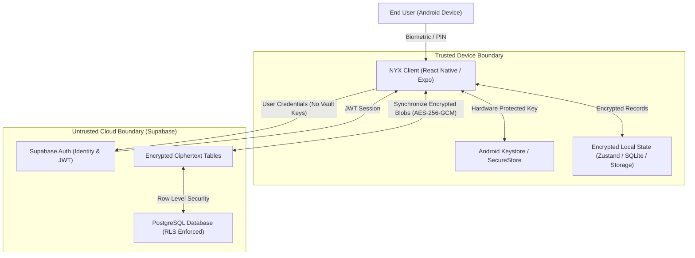
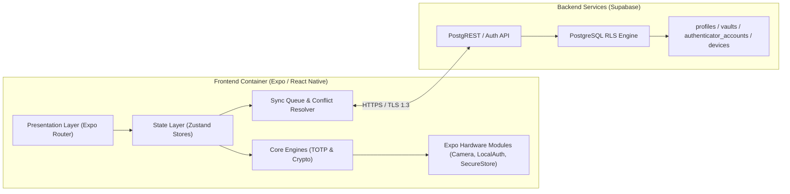
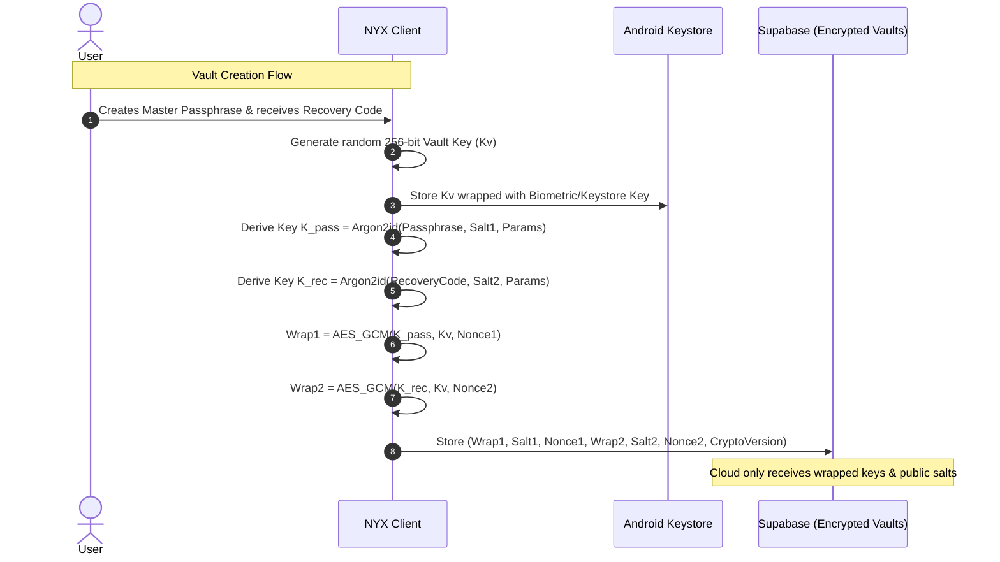
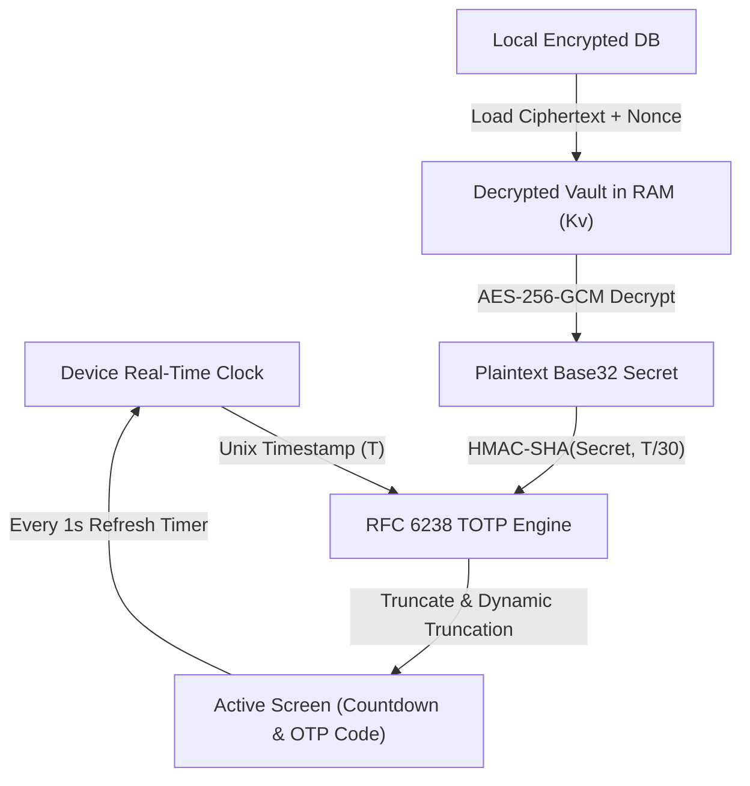
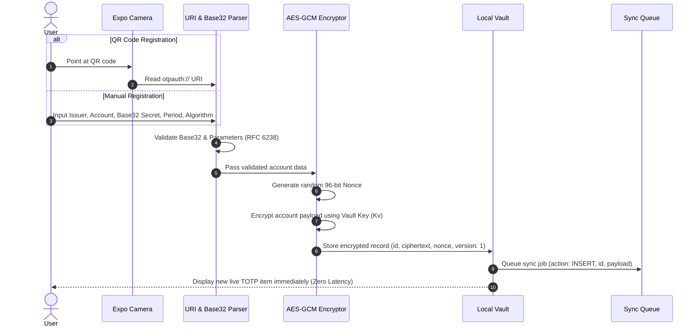
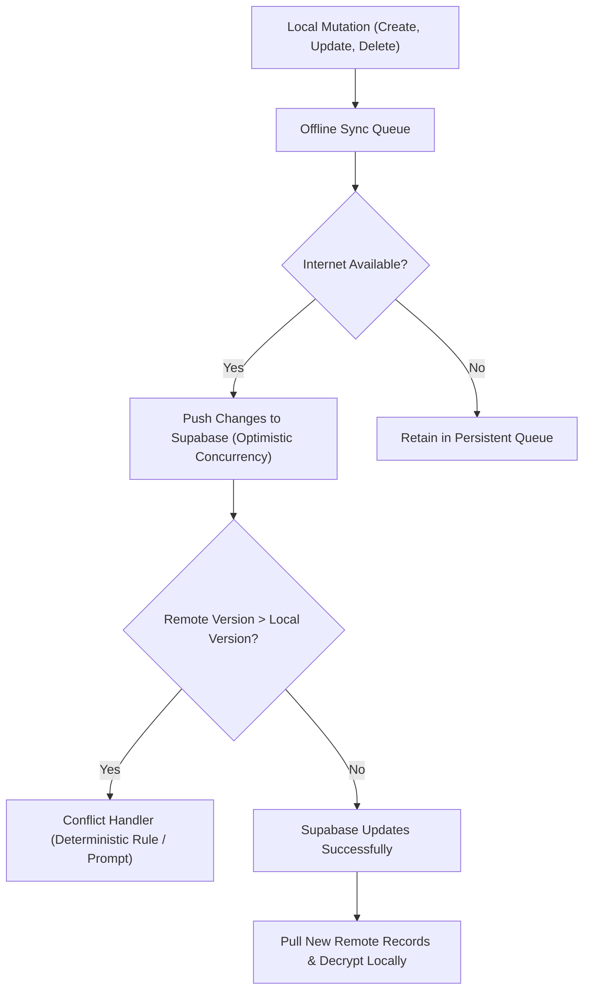

# NYX Architecture Specification

This document provides a comprehensive technical overview of NYX: system context, container topology, frontend/backend architecture, cryptographic data flows, synchronization models, and failure modes.

---

## 1. System Context & Trust Boundaries

NYX operates with a zero-trust model toward the cloud backend. The cloud is treated as an untrusted, semi-honest synchronization relay.

### Trust Zones
1. **Trusted Execution Zone:** The NYX mobile app process, local memory, and Android Keystore hardware security module.
2. **Untrusted Transit & Cloud Zone:** Supabase Auth, PostgreSQL tables, network edge. The backend receives only encrypted blobs, KDF parameters, salts, and nonces.

---

## 2. Container Architecture

---

## 3. Cryptographic Architecture & Data Flow

### 3.1 Vault Key Derivation & Wrapping

A randomly generated 256-bit symmetric **Vault Key** ($K_v$) encrypts all local TOTP account records. $K_v$ is never transmitted anywhere in plaintext.

### 3.2 TOTP Generation Flow (Completely Offline)

---

## 4. Account Registration Flow (QR Code & Manual)

---

## 5. Offline-First Cloud Synchronization Flow

Synchronization is bidirectional, non-blocking, and handles network disruption gracefully.

---

## 6. Failure Scenarios & Mitigations

| Failure Mode | Impact | Mitigation Strategy |
| :--- | :--- | :--- |
| **Complete Network Loss** | Cannot contact Supabase. | Full offline mode: OTP generation, local scanning, and edits remain 100% operational; sync operations queue persistently. |
| **Biometric Failure / Lockout** | Cannot unlock Keystore. | Fallback to device PIN/Pattern, or enter the Master Passphrase to unwrap the Vault Key. |
| **Lost Device** | Physical device gone. | Restore on a new device using Supabase Auth + Master Passphrase or 24-word Recovery Code. |
| **Compromised Backend** | Attacker breaches Supabase database. | Attacker obtains only AES-256-GCM ciphertext, Argon2id salts, and wrapped keys. Without the client passphrase or device Keystore, plaintext secrets cannot be decrypted. |
| **Sync Race Condition** | Edits made on two devices concurrently. | Optimistic concurrency version checks (`version` column) reject stale updates; local tombstones prevent resurrecting deleted accounts. |
