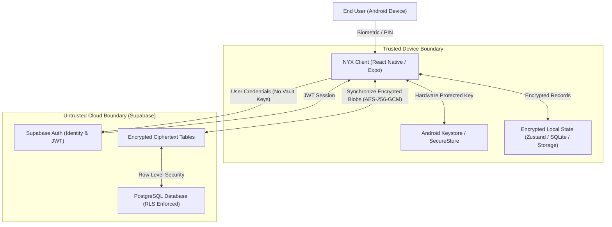
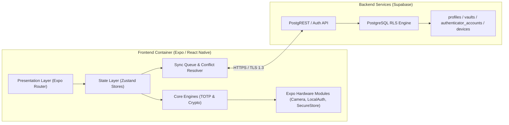
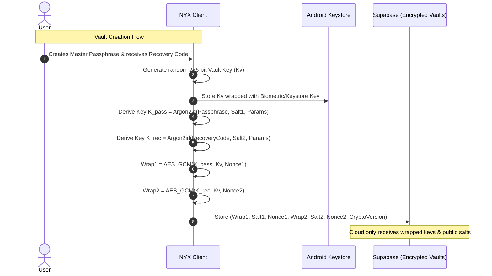
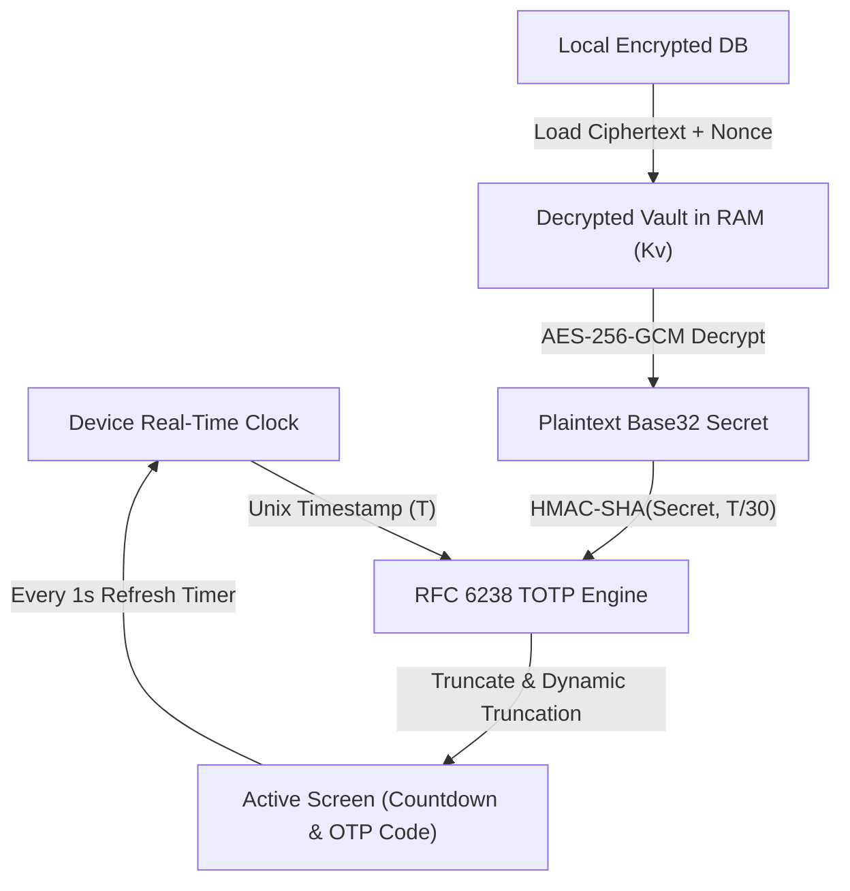
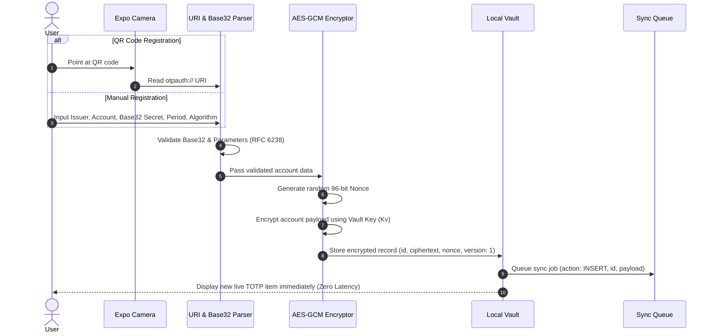
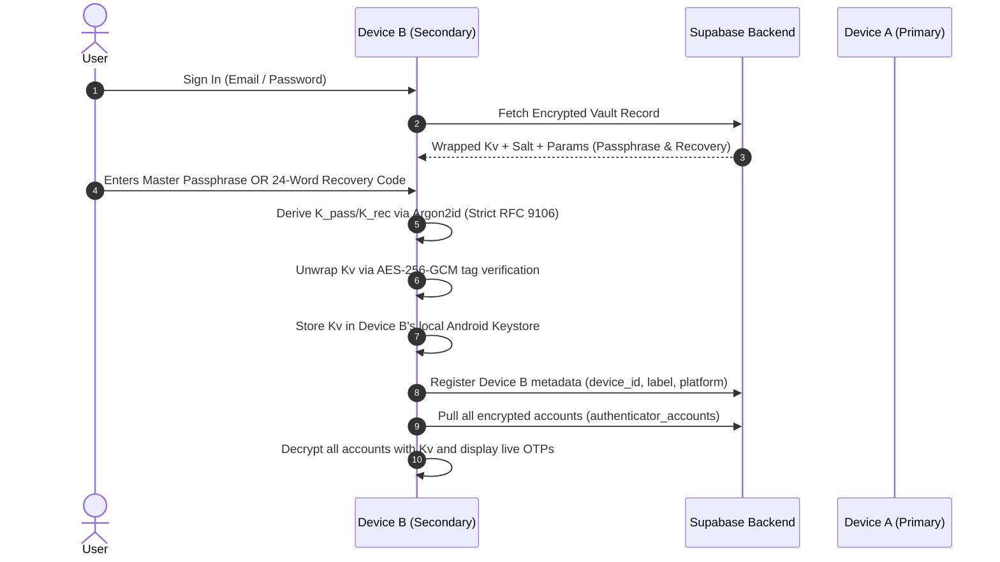
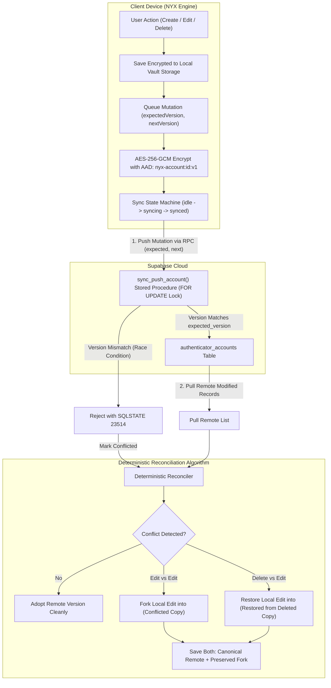

# NYX Architecture Specification

This document provides a comprehensive technical overview of NYX: system context, container topology, frontend/backend architecture, cryptographic data flows, synchronization models, and failure modes.

---

## 1. System Context & Trust Boundaries

NYX operates with a zero-trust model toward the cloud backend. The cloud is treated as an untrusted, semi-honest synchronization relay.

### Trust Zones
1. **Trusted Execution Zone:** The NYX mobile app process, local memory, and Android Keystore hardware security module.
2. **Untrusted Transit & Cloud Zone:** Supabase Auth, PostgreSQL tables, network edge. The backend receives only encrypted blobs, KDF parameters, salts, and nonces.

---

## 2. Container Architecture

---

## 3. Cryptographic Architecture & Data Flow

### 3.1 Vault Key Derivation & Wrapping

A randomly generated 256-bit symmetric **Vault Key** ($K_v$) encrypts all local TOTP account records. $K_v$ is never transmitted anywhere in plaintext.

### 3.2 TOTP Generation Flow (Completely Offline)

---

## 4. Account Registration Flow (QR Code & Manual)

---

## 5. Offline-First Cloud Synchronization Architecture (Phase 5)

Synchronization is bidirectional, non-blocking, and handles intermittent connectivity, network disruptions, and multi-device concurrent edits with zero data loss.

### 5.1 Multi-Device Enrollment Protocol
When a secondary device (Device B) is enrolled into an existing user account:

### 5.2 Atomic Compare-And-Swap (CAS) & Deterministic Reconciliation

### 5.3 Tombstone Deletion, Anti-Resurrection & Delete-vs-Update Conflicts
1. **Tombstone Propagation:** Deletions publish a tombstone (`deleted_at = now()`) with an incremented version counter.
2. **Anti-Resurrection Invariant:** Reconcilers respect tombstones when `remote.version >= local.version`, removing the account from local active sets.
3. **Delete-vs-Update Conflict Resolution (Zero Data Loss):** If Device A deleted an account and Device B modified that account while offline:
   - The canonical account ID is removed (honoring the tombstone deletion).
   - Device B's local modifications are preserved as a brand new account record with a fresh UUID and label `(Restored from Deleted Copy)`.
   - The preserved copy is re-encrypted with fresh nonces and bound AAD, ensuring zero data loss and preventing future resurrection of the deleted ID.

### 5.4 Device Revocation Boundaries & Key Rotation Protocol
- **Revocation Boundary:** Deleting a record from `devices` table purges sync query authorization, but does **not** cryptographically erase the Vault Key from hardware in an adversary's physical possession.
- **Vault Key Rotation:** Evicting a compromised device requires generating a new 256-bit key $K_v'$, re-encrypting all active accounts under $K_v'$, updating passphrase and recovery wrappers, and re-enrolling authorized devices.

---

## 6. Failure Scenarios & Mitigations

| Failure Mode | Impact | Mitigation Strategy |
| :--- | :--- | :--- |
| **Complete Network Loss** | Cannot contact Supabase. | Full offline mode: OTP generation, local scanning, and edits remain 100% operational; sync operations queue persistently. |
| **Biometric Failure / Lockout** | Cannot unlock Keystore. | Fallback to device PIN/Pattern, or enter the Master Passphrase to unwrap the Vault Key. |
| **Lost Device** | Physical device gone. | Restore on a new device using Supabase Auth + Master Passphrase or 24-word Recovery Code. |
| **Compromised Backend** | Attacker breaches Supabase database. | Attacker obtains only AES-256-GCM ciphertext, Argon2id salts, and wrapped keys. Without the client passphrase or device Keystore, plaintext secrets cannot be decrypted. |
| **Sync Race Condition** | Edits made on two devices concurrently. | Optimistic concurrency version checks (`version` column) reject stale updates; local tombstones prevent resurrecting deleted accounts. |
